# Pruebas funcionales — Control de equipos de laboratorio

**Proyecto:** ControlEquiposLabG3  
**Tecnologías:** JavaFX, Hibernate ORM y PostgreSQL  
**Base de datos:** `bd_laboratorio_orm`  
**Esquema:** `inventario`  
**Resultado de la ejecución reportada:** P1–P8 completadas satisfactoriamente.

Este documento registra las pruebas realizadas por el autor de la aplicación. Los resultados se basan en las capturas aportadas y en su confirmación de haber ejecutado todos los casos. Las imágenes se encuentran en la carpeta `evidencias`, junto a este documento.

## Matriz de pruebas

| ID | Prueba e información de entrada | Resultado esperado | Resultado obtenido | Estado |
| --- | --- | --- | --- | --- |
| P1 | Registrar `EQ-009`, nombre `Monitor de Prueba`, marca `LG`, tipo `Periféricos`, estado `Disponible` y cantidad `2`. | Guardar el equipo y mostrarlo en el inventario. | Se mostró «El equipo se guardó correctamente». El registro EQ-009 apareció en el inventario y el total pasó a nueve equipos. | Aprobada |
| P2 | Intentar registrar otro equipo con código `EQ-001`, nombre `Equipo Duplicado de Prueba`, marca `Prueba`, tipo `Computadoras`, estado `Disponible` y cantidad `1`. | Rechazar el código repetido sin cerrar la aplicación ni registrar un duplicado. | Se mostró «Ya existe un equipo con ese código. Utilice un código diferente». La consola registró SQLState `23505` y la violación de `uq_equipo_codigo`. | Aprobada |
| P3 | Seleccionar EQ-009 y modificar su nombre, tipo a `Computadoras` y estado a `En mantenimiento`. | Guardar los cambios y actualizar el listado. | Se mostró «El equipo se actualizó correctamente». EQ-009 apareció con el nombre modificado, tipo Computadoras, estado En mantenimiento y cantidad 2. | Aprobada |
| P4 | Eliminar EQ-009 aceptando la confirmación. | Retirar el registro del inventario y de PostgreSQL. | Se mostró «El equipo se eliminó correctamente». El total pasó de nueve a ocho equipos; la consola mostró la sentencia DELETE generada por Hibernate. La ejecución de la confirmación fue reportada por el autor. | Aprobada |
| P5 | Buscar por el fragmento de nombre `laptop`. | Mostrar únicamente equipos cuyos nombres contengan ese fragmento. | El autor confirmó la ejecución satisfactoria de la búsqueda parcial. Los equipos esperados son EQ-001 y EQ-003; ambos también se observan en la búsqueda combinada de P6. | Aprobada |
| P6 | Filtrar por tipo y combinar `laptop` con `Computadoras` y con `Proyectores`. | Mostrar equipos que cumplan todas las condiciones activas. | Computadoras sin texto: tres resultados. Proyectores sin texto: dos resultados. `laptop` + Computadoras: EQ-001 y EQ-003. `laptop` + Proyectores: cero resultados. | Aprobada |
| P7 | Intentar guardar un equipo llamado `Prueba Negativa`, tipo `Computadoras`, estado `Disponible` y cantidad `-1`. | Rechazar la cantidad antes de guardar. | Se mostró «La cantidad no puede ser negativa». El inventario conservó ocho resultados en la captura. | Aprobada |
| P8 | Registrar `EQ-010`, nombre `Equipo de Persistencia`, marca `Prueba`, tipo `Computadoras`, estado `Disponible` y cantidad `1`; cerrar y volver a abrir la aplicación. | Conservar el registro y sus atributos después del reinicio. | El autor confirmó el cierre y la reapertura. La evidencia posterior muestra EQ-010 en el inventario, con sus datos cargados al seleccionar la fila y un total de nueve resultados. | Aprobada |

## P1. Registro de un equipo válido

El registro se realizó mediante el formulario de la aplicación. Se mostró el mensaje de éxito y el inventario reflejó la incorporación del equipo.

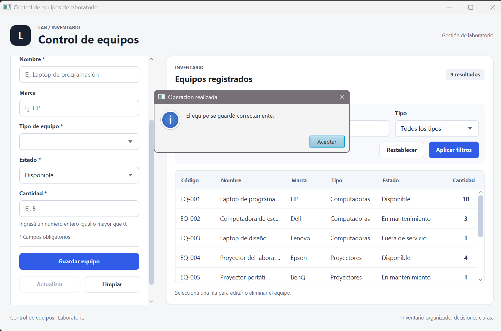

## P2. Código duplicado e integridad

Se intentó utilizar el código EQ-001, que ya pertenecía a un equipo. La aplicación mostró un mensaje comprensible y permaneció abierta.

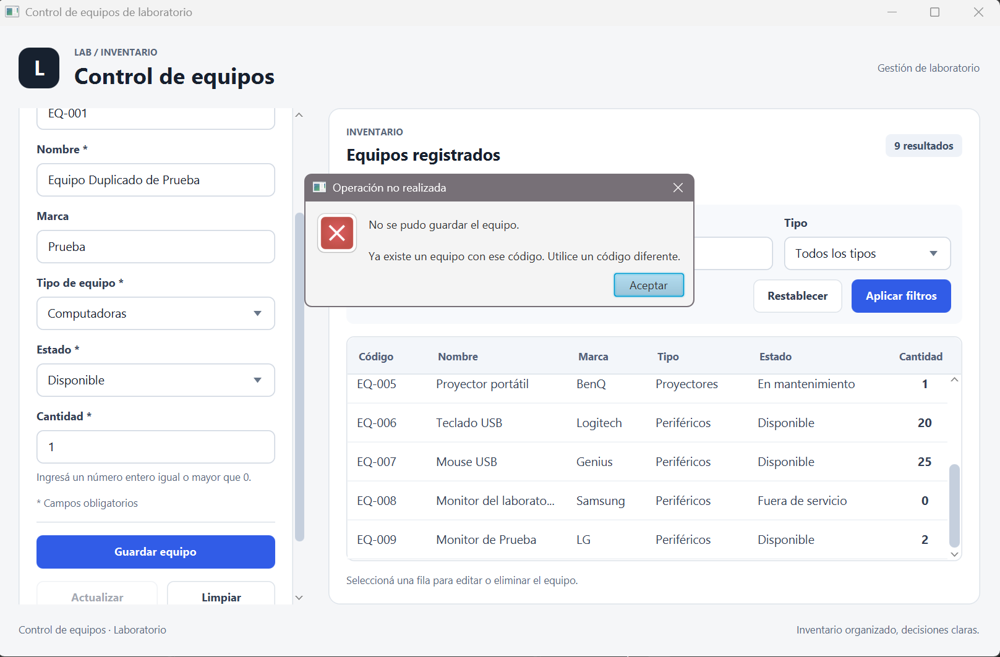

La evidencia técnica registra una escritura rechazada por PostgreSQL: SQLState `23505`, restricción `uq_equipo_codigo` y código duplicado EQ-001. Aunque el archivo se llama `P2-verificacion-sql.png`, su contenido es la consola de Hibernate/PostgreSQL.

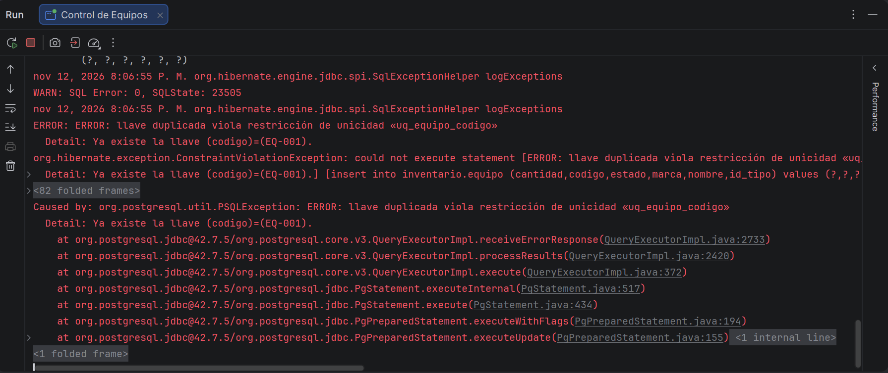

### Manejo de la transacción y rollback

En `EquipoDAO.guardar()`, la operación comienza con `tx.begin()`, utiliza `em.persist(equipo)` y solo confirma mediante `tx.commit()` cuando concluye correctamente.

Si se produce una excepción, el bloque `catch` comprueba si la transacción sigue activa y ejecuta `tx.rollback()`. Después vuelve a lanzar la excepción para que el controlador muestre el error. El `EntityManager` se cierra en `finally`.

```java
} catch (RuntimeException ex) {
    if (tx.isActive()) {
        tx.rollback();
    }
    throw ex;
} finally {
    em.close();
}
```

El intento duplicado fue rechazado y no se confirmó un nuevo registro. La captura de consola evidencia la restricción que produjo el fallo; la llamada a `rollback()` se explica mediante el bloque de manejo de transacciones del DAO, no mediante un mensaje de rollback visible en esa captura. Esta operación contiene una sola inserción.

## P3. Actualización de un equipo

Se modificó el nombre de EQ-009 y se cambió su asociación al tipo Computadoras y su estado a En mantenimiento. La tabla mostró los nuevos valores después de confirmar la actualización.

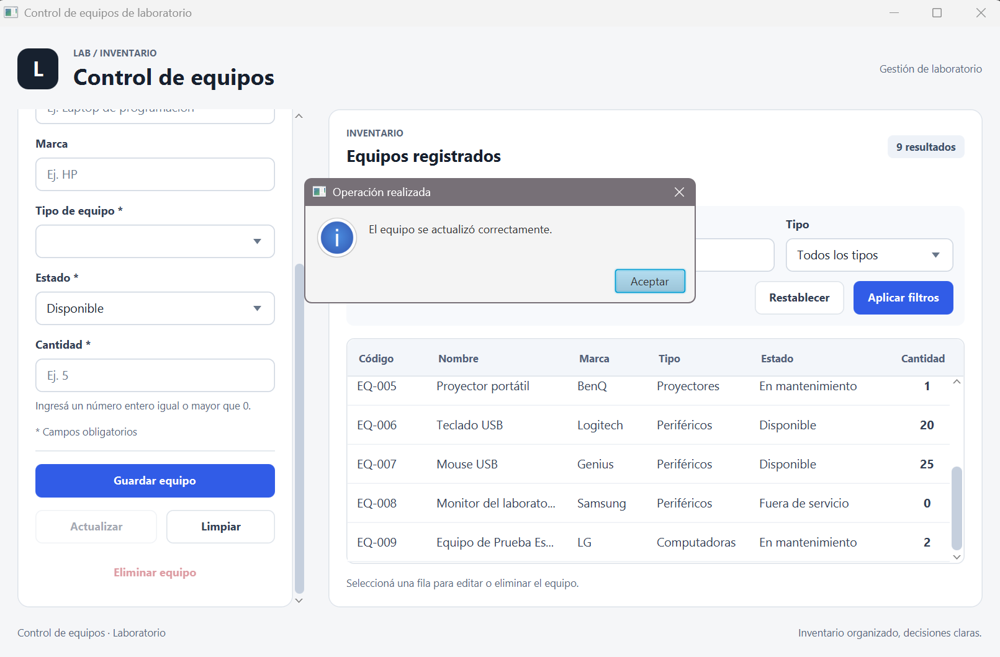

## P4. Eliminación de un equipo

La eliminación se realizó después de aceptar la confirmación, según la ejecución reportada. La aplicación mostró el mensaje de éxito y el contador quedó en ocho registros.

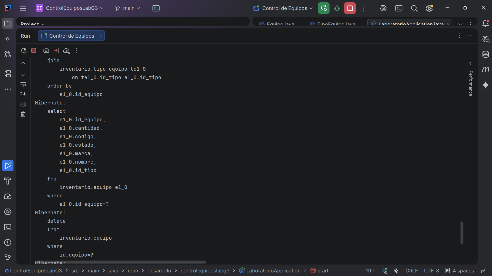

El archivo siguiente, guardado con el nombre indicado durante la preparación, muestra la consulta y el DELETE generados por Hibernate. Documenta la operación de persistencia; no muestra el diálogo previo de confirmación.

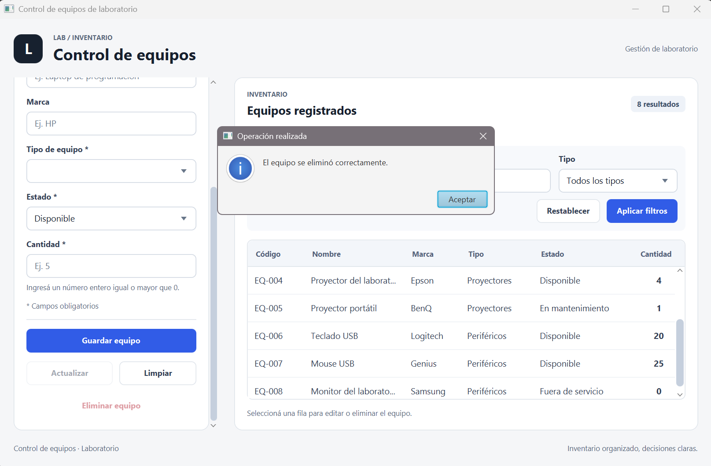

## P5. Búsqueda por nombre parcial

El autor confirmó la búsqueda por el fragmento `laptop`, con EQ-001 y EQ-003 como coincidencias. La búsqueda utiliza una consulta JPQL parametrizada con `LOWER(e.nombre) LIKE :nombre`.

La captura guardada como `P5-busqueda.png` muestra el filtro por Computadoras sin texto de búsqueda y tres resultados. Se conserva con su nombre original; la ejecución de la búsqueda solo por nombre se registra según la confirmación del autor. La captura de P6 combinado aporta evidencia adicional de coincidencias por nombre, junto con el filtro de tipo.

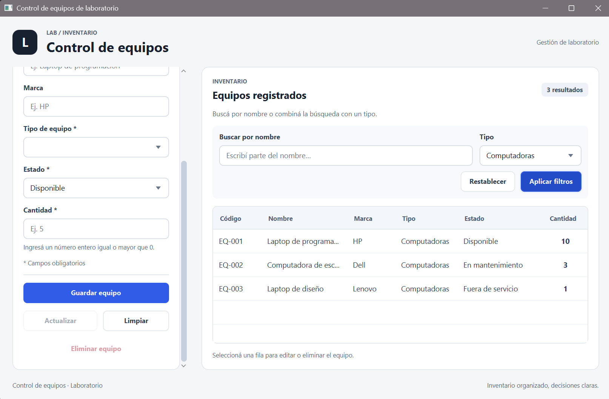

## P6. Filtros y búsqueda combinada

La combinación aplica simultáneamente una condición de nombre y otra de tipo. Cambiar el tipo reemplaza la selección anterior de ese control; el texto de búsqueda se mantiene como una condición adicional.

### Filtro por tipo

Con Proyectores y sin texto de búsqueda se mostraron EQ-004 y EQ-005.

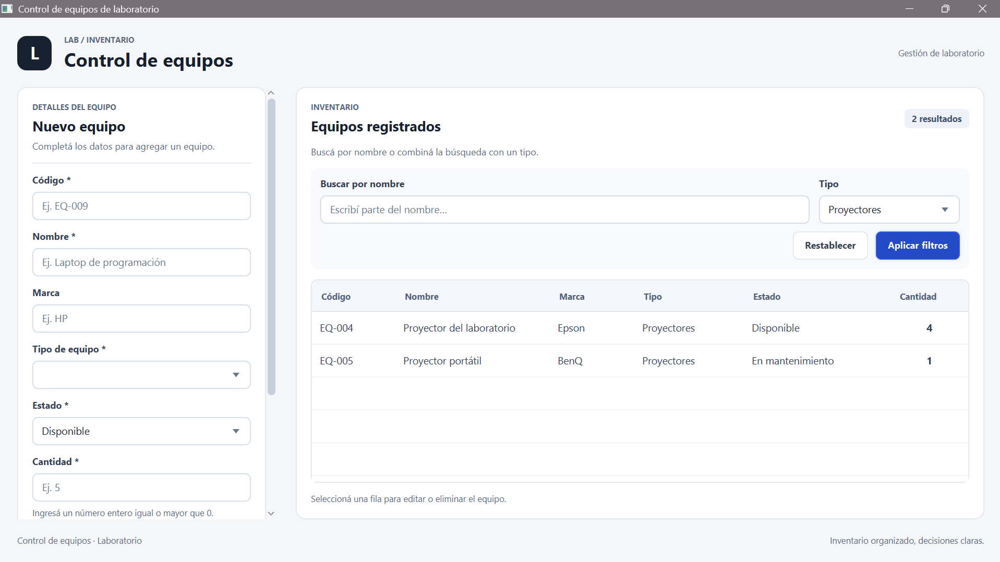

### Nombre y tipo con coincidencias

Con `laptop` y Computadoras se mostraron dos equipos: EQ-001, Laptop de programación, y EQ-003, Laptop de diseño.


### Nombre y tipo sin coincidencias

Con `laptop` y Proyectores se mostraron cero resultados y el mensaje «Sin equipos para mostrar».

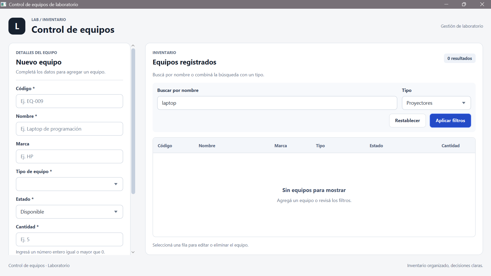

## P7. Validación de cantidad negativa

Al ingresar -1, la aplicación mostró una advertencia y rechazó el dato. Esta comprobación corresponde a una validación del formulario, distinta del error de integridad provocado en P2.

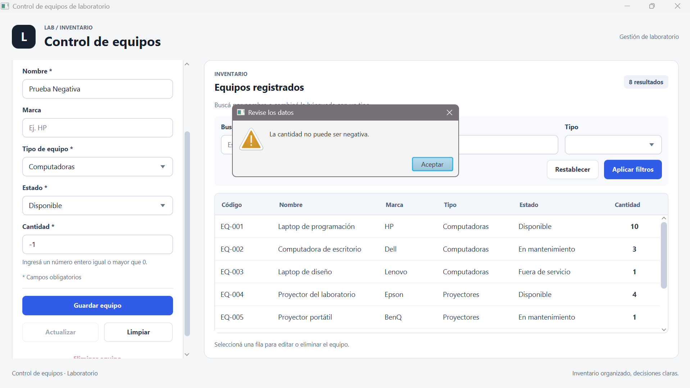

## P8. Persistencia después de reiniciar

Se registró EQ-010 con nombre Equipo de Persistencia, marca Prueba, tipo Computadoras, estado Disponible y cantidad 1. El autor confirmó que cerró y volvió a abrir la aplicación.

### Antes del reinicio

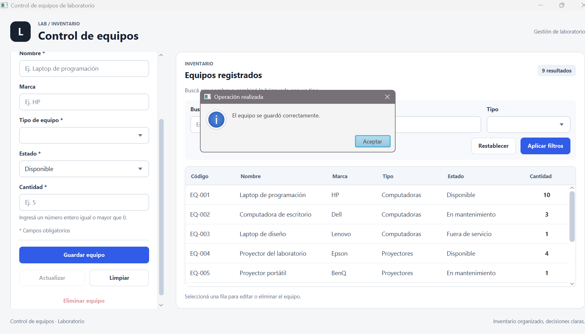

### Después del reinicio

La captura posterior muestra EQ-010 seleccionado y sus atributos cargados en el formulario. El inventario contiene nueve resultados.

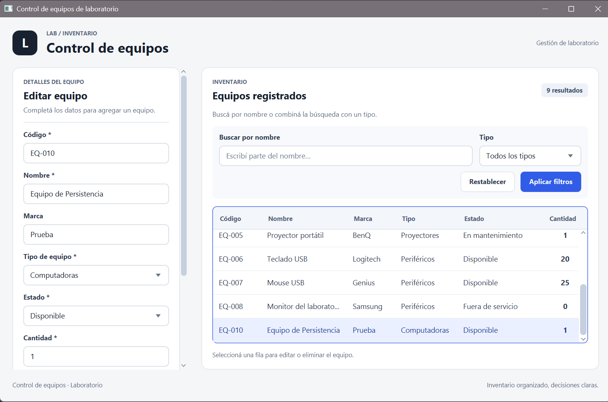

## Relación con la rúbrica

| Criterio | Evidencia |
| --- | --- |
| Entidades y relación | Los equipos muestran el nombre de su tipo; P3 modifica la asociación y refleja el cambio. El mapeo se verifica en `Equipo` y `TipoEquipo`. |
| CRUD y transacciones | P1, P3 y P4 documentan altas, cambios y bajas. P2 provoca una escritura fallida y se acompaña de la explicación del rollback. |
| Consultas y TableView | P5 registra la búsqueda parcial reportada; P6 muestra filtro por tipo, combinación y ausencia de coincidencias. |
| Validaciones e integridad | P2 comprueba código único y P7 cantidad negativa. |
| Organización y documentación | README, script SQL, este documento y capturas en `docs/evidencias`. |

**Repositorio:** https://github.com/rjez12/ControlEquiposLabG3

